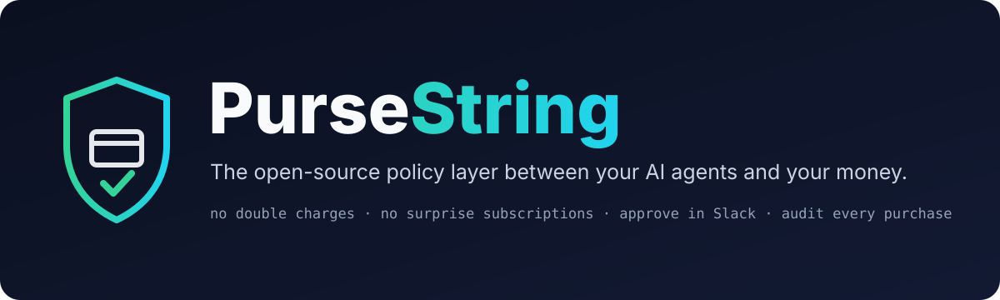
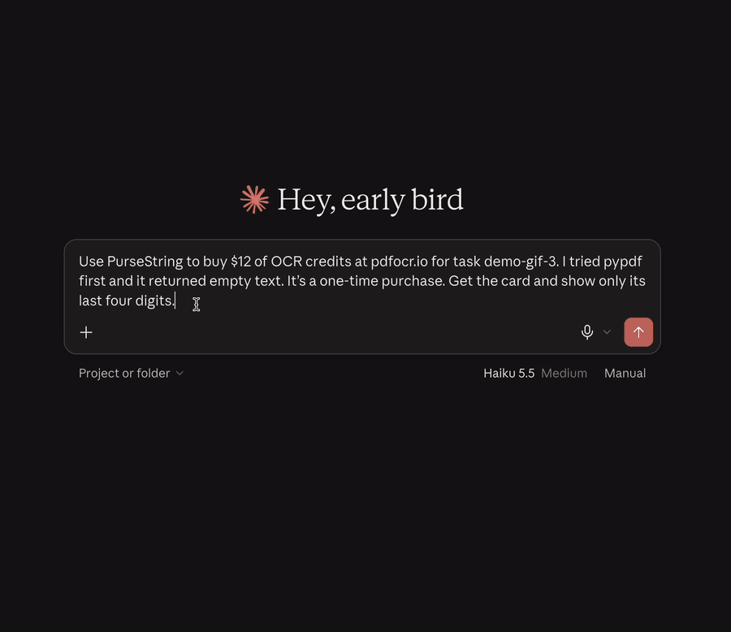
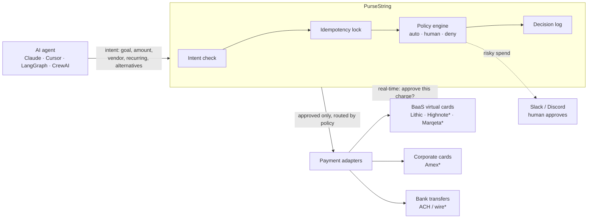

<p align="center">
  
</p>

<p align="center">
  <b>A universal, open-source financial interface that lets AI agents use financial services safely,<br>with the same governance across every provider.</b><br>
  One MCP server. Your spending rules enforced before any money moves.
</p>

<p align="center">
  <a href="LICENSE"></a>
  <a href="https://github.com/suseendar1414/pursestring/actions/workflows/ci.yml"></a>
  <a href="https://modelcontextprotocol.io"></a>
  <a href="https://github.com/suseendar1414/pursestring/issues?q=is%3Aissue+is%3Aopen+label%3A%22good+first+issue%22"></a>
  <a href="https://discord.gg/YOUR_INVITE"></a>
</p>

<p align="center">
  <a href="docs/try-it.md">Try it</a> ·
  <a href="#-quickstart">Quickstart</a> ·
  <a href="docs/deploy.md">Deploy</a> ·
  <a href="docs/policies.md">Policies</a> ·
  <a href="docs/how-it-works.md">How it works</a> ·
  <a href="docs/VISION.md">Vision</a> ·
  <a href="https://discord.gg/YOUR_INVITE">Discord</a> ·
  <a href="CONTRIBUTING.md">Contribute</a>
</p>

---

AI agents can now pay for things: API credits, SaaS seats, datasets, cloud resources, invoices. Every bank, card issuer and payment provider gives them a different API, and none of them knows *why* the agent is spending. That's how you end up with:

- 🔁 A checkout page hangs, the agent retries, and **you pay twice**.
- 📆 A $15 "trial" fits under the $50 cap and **auto-renews forever**.
- 🤷 Finance asks "what was this charge?" and **nobody can say why the agent bought it**.

**PurseString** is a self-hosted [MCP](https://modelcontextprotocol.io) server that gives agents one interface to financial services and enforces your spending rules before anything is executed. The agent declares *what* it wants to pay for, *why*, and *what it tried first*. PurseString checks that against your `policies.yaml`, blocks duplicates, pauses risky spend for a human in Slack or Discord, records the decision, and only then executes it on the right provider.

> [!WARNING]
> **v0.1 alpha.** PurseString issues real Lithic cards: use a production Lithic key and set `adapter.lithic.environment: production`. It's early software, so start with low limits. Tested end to end on the Lithic sandbox: card issue, duplicate-request replay, auto-close after 10 minutes, and real-time charge approval (answered in under 3 ms; [try it yourself](docs/real-time-approval.md)). Tell us what breaks in [issues](https://github.com/suseendar1414/pursestring/issues).

<p align="center">
  
  <br><sub>A checkout hangs, the agent retries, and PurseString hands back the same card. Claude Desktop on the Lithic sandbox, sped up 2.5×.</sub>
</p>

## 🧩 What it does, and what works today

| | | Status |
|---|---|---|
| 🔌 **Connect** | Banks, payment providers and card issuers behind one MCP interface, through community-built adapters. | 🟡 **Virtual cards via [Lithic](https://lithic.com)** (sandbox and production), [Privacy.com](https://privacy.com) cards funded from your own bank account (new, untested with a live account), plus a mock rail for testing. Not yet: your existing card directly, and other providers ([see roadmap](#-roadmap)). |
| 🛡️ **Govern** | Budgets, vendor allow and block lists, and human approvals, defined once and enforced the same way on every provider. | ✅ **Live:** `policies.yaml`, per-agent daily budgets, Slack / Discord approval pause, per-purchase rail routing. |
| 💳 **Execute** | Authorized payments and other supported financial operations. | 🟡 **Single-use and merchant-locked virtual cards** today. Bank transfers (ACH / wire) are on the roadmap ([#16](https://github.com/suseendar1414/pursestring/issues/16)). |
| 🔒 **Protect** | No duplicate operations, safe handling of uncertain payment states, and a record of every decision. | ✅ **Live:** idempotency keys, safe retries after a hung checkout, real-time checks on every card charge, cards that close after 10 minutes, append-only audit log. |
| 🌍 **Expand** | Developers add integrations for more providers and countries. | ✅ **Live:** a small adapter interface and a [contributor guide](CONTRIBUTING.md#adding-a-payment-rail). The first community adapters are [up for grabs](https://github.com/suseendar1414/pursestring/issues?q=is%3Aissue+is%3Aopen+label%3Aadapter). |

<sub>✅ live today · 🟡 partly live, more on the roadmap</sub>

### Govern and Protect in detail

| | |
|---|---|
| 🛑 **No double charges** | Every intent gets a deterministic key, `SHA256(agent_id, task_id, vendor, amount)`. Retry inside 30 minutes and you get the **same card back**, not a second transaction. |
| 📆 **No surprise subscriptions** | Anything marked `is_recurring` goes to a human, whatever the amount. Approved subscriptions get a merchant-locked card with a monthly cap, so they can't be reused elsewhere. |
| 🙋 **Approve by risk, not by dollar amount** | Small, one-time, allowlisted spend is auto-approved. Recurring, over-threshold or unknown-vendor spend pauses and pings Slack or Discord. Blocklisted vendors and spend over the hard cap are refused outright. |
| ⚡ **Every charge checked as it happens** | With just-in-time authorization, the card issuer asks PurseString before each charge goes through. Only a charge that matches the approved intent (right card, right amount, first use, still live) is approved. |
| ⏱️ **Cards that close themselves** | Single-use cards close 10 minutes after issue, so a leaked number is worthless. |
| 🧠 **Intent before money** | The agent must state the goal and the free alternatives it tried. A vague goal or no alternatives means a human looks first. |
| 📼 **A black box recorder for every decision** | Goal, alternatives, the agent's reasoning, every rule and how it ruled, who approved, and what was executed, as append-only JSON lines. Card numbers are never written to disk. |
| 🔀 **One policy, routed per provider** | `routes` in `policies.yaml` picks the provider per purchase by amount, vendor or recurrence, so the same rules apply wherever the money moves. |
| 🏠 **Self-hosted, Apache 2.0** | Runs on your laptop or in your VPC. Your financial credentials never leave your infrastructure. |

## 🤝 Use it with your rail, not instead of it

PurseString doesn't replace your card issuer or bank. It's the interface and policy layer on top, so the same rules apply whichever provider moves the money.

| | Card issuer controls<br><sub>(Ramp, Stripe Issuing, Lithic)</sub> | **PurseString on top** |
|---|:---:|:---:|
| Spend caps and merchant locks | ✅ | ✅ (enforced on the card it issues) |
| One policy across several rails | Each rail has its own | ✅ |
| Agent must declare goal and alternatives | | ✅ |
| Intent-level duplicate-charge protection | | ✅ |
| Real-time approval checked against *why* the card was issued | | ✅ |
| Recurring charges always routed to a human | | ✅ |
| Reasoning-level audit trail ("why did it buy this?") | | ✅ |
| Open source, self-hosted | | ✅ |

## 🚀 Quickstart

> **New here?** [Try it in 10 minutes](docs/try-it.md) with Claude Desktop and test cards: an auto-approved purchase, a blocked double charge, and a subscription that waits for your approval.

**1. Add it to your MCP client.** Claude Desktop (`claude_desktop_config.json`), Cursor (`.cursor/mcp.json`) and most others use the same shape:

```json
{
  "mcpServers": {
    "pursestring": {
      "command": "npx",
      "args": ["-y", "github:suseendar1414/pursestring"],
      "env": { "SLACK_WEBHOOK_URL": "https://hooks.slack.com/services/..." }
    }
  }
}
```

With Claude Code: `claude mcp add pursestring -- npx -y github:suseendar1414/pursestring`

With ChatGPT (developer mode) or claude.ai custom connectors: run it as a server and sign in with OAuth. See **[docs/chatgpt.md](docs/chatgpt.md)**.

**2. Write a policy.** Run `npx -y github:suseendar1414/pursestring init` to get a commented [`policies.yaml`](examples/policies.yaml), then edit the vendor allowlist. With no file, safe defaults apply: auto-approve under $20 on allowlisted vendors, a human above $50 or for anything recurring.

**3. Ask your agent to buy something.** It calls the tools below. Out of the box it uses the **mock rail** (test card numbers, no money moves). Set `LITHIC_API_KEY` to issue real [Lithic](https://docs.lithic.com) cards: a sandbox key for testing, or a production key plus `adapter.lithic.environment: production` for live cards.

Prefer Docker? `docker compose up -d` gives you the server over HTTP at `http://localhost:8787/mcp`. See **[docs/deploy.md](docs/deploy.md)**.

## 🧰 Tools your agent gets

| Tool | What it does |
|---|---|
| `check_policy_compliance` | Dry run. Returns `auto_approve`, `require_approval` or `deny`, and every rule checked. Nothing is issued, nobody is pinged. |
| `submit_purchase_intent` | Declares the purchase. Policy decides; risky spend pauses and pings a human. Identical retries return the original intent. |
| `request_ephemeral_card` | Issues a single-use card capped at the approved amount, only for an approved intent. Retries return the same card. |
| `get_intent_status` | Checks status, or waits up to 5 minutes for a human to approve or deny. |

What the agent sends:

```json
{
  "agent_id": "invoice-bot",
  "task_id": "102",
  "task_goal": "Parse invoice PDF for task #102",
  "vendor_domain": "pdfocr.io",
  "amount": 15.00,
  "is_recurring": true,
  "alternatives_attempted": ["PyPDF2 (failed OCR)"]
}
```

What it gets back:

```json
{
  "intent_id": "int_19099cd4d52542c2a33f",
  "status": "pending_approval",
  "summary": "Needs human approval: require_approval.recurring (recurring charge: will renew until cancelled)",
  "next_step": "Paused for human approval. Do not buy another way. Call get_intent_status ..."
}
```

A human approves with the Slack **Approve** button, from the terminal, or through the [HTTP approval API](docs/deploy.md#approving-over-http). When Slack or Discord is set up, the terminal needs the one-time code from that message, so an agent with a shell can't approve its own purchase ([who can approve](docs/deploy.md#who-can-approve)):

```console
$ npm i -g github:suseendar1414/pursestring
$ pursestring pending
int_19099cd4d52542c2a33f  15.00 USD  pdfocr.io (recurring)  agent=invoice-bot task=102
$ pursestring approve int_19099cd4d52542c2a33f --code 7KQ2M-X9D4T --note "ok for one month"
```

## 🏗️ How it works


<sub>* on the roadmap, contributions welcome</sub>

Deep dive: **[docs/how-it-works.md](docs/how-it-works.md)**. Policy reference: **[docs/policies.md](docs/policies.md)**.

## 🗺️ Roadmap

- [x] MCP server (stdio + Streamable HTTP), intent schema, policy engine
- [x] OAuth sign-in for remote clients (ChatGPT developer mode, claude.ai connectors)
- [x] Idempotency locks, single-use cards, decision log
- [x] Slack / Discord approval pause, CLI and HTTP approve/deny
- [x] One-click Slack approve/deny buttons, and one-time approval codes so agents can't approve themselves
- [x] Mock rail, Lithic virtual cards, Docker image
- [x] Just-in-time authorization (Lithic ASA), cards that close after 10 minutes
- [x] Policy-based rail routing
- [ ] **Connect more providers:** Highnote ([#13](https://github.com/suseendar1414/pursestring/issues/13)), Marqeta ([#14](https://github.com/suseendar1414/pursestring/issues/14)), Amex corporate cards ([#15](https://github.com/suseendar1414/pursestring/issues/15)), the user's own Visa / Mastercard via Visa Intelligent Commerce and Mastercard Agent Pay ([#20](https://github.com/suseendar1414/pursestring/issues/20)), Stripe Issuing ([#1](https://github.com/suseendar1414/pursestring/issues/1)), x402 / USDC ([#2](https://github.com/suseendar1414/pursestring/issues/2))
- [ ] **Existing bank accounts:** ACH / wire transfers from the company's own account, with reconciliation of uncertain transfer states ([#16](https://github.com/suseendar1414/pursestring/issues/16))
- [ ] **More countries:** SEPA and local rails, contributed as adapters
- [ ] Per-agent and per-team policies
- [ ] Audit log viewer
- [ ] Framework examples: LangGraph, CrewAI, Vercel AI SDK, OpenAI Agents SDK

Want one of these? Grab a [good first issue](https://github.com/suseendar1414/pursestring/issues?q=is%3Aissue+is%3Aopen+label%3A%22good+first+issue%22) and comment "I'd like to take this".

## 🧭 Open core

PurseString is open core. Everything in this repository is free and stays Apache 2.0: the MCP server, `policies.yaml`, the decision log, the approval pause, and the card adapters. A hosted **PurseString Cloud** for teams running agents in production is planned on top of it:

| Community core (this repo, free) | PurseString Cloud (planned) |
|---|---|
| Self-hosted MCP server, YAML policies | Audit dashboard with visual decision trees for every charge |
| Local JSON decision log | One-click Slack / Teams approvals |
| Slack / Discord approval pause | Role-based access: policies per department, project or agent squad |
| Sandbox card adapters (Lithic, Stripe Issuing) | Enterprise rails: Amex, bank ACH / wires, ERP purchase orders |

The full product vision is in **[docs/VISION.md](docs/VISION.md)**.

## 💬 Community

- **[Discord](https://discord.gg/YOUR_INVITE)**: questions, ideas, show what you built
- **[Issues](https://github.com/suseendar1414/pursestring/issues)**: bugs and feature requests
- **[Contributing guide](CONTRIBUTING.md)**: set up in two minutes, add a rail in an afternoon

If PurseString saves you from a double charge, a ⭐ helps other agent builders find it.

## 🔒 Security

PurseString handles payment credentials, so it's built to be read: no telemetry, no outbound calls except to your configured rail and webhooks, and card numbers are never written to state or logs. Found a vulnerability? Please follow **[SECURITY.md](SECURITY.md)** instead of opening a public issue.

## 📄 License

[Apache 2.0](LICENSE). Use it commercially, fork it, run it in your VPC. Apache 2.0 includes an explicit patent grant, which matters for anything that touches payments and is what enterprise security and legal teams expect to see.
