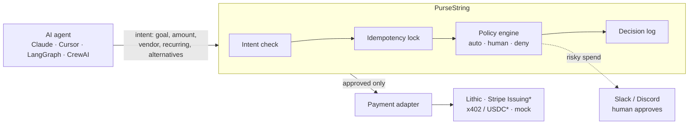

<p align="center">
  
</p>

<p align="center">
  <b>Open-source alternative to closed agent-card controls like Ramp Agent Cards, for any payment rail.</b><br>
  Your agent has a card. PurseString gives it judgment.
</p>

<p align="center">
  <a href="LICENSE"></a>
  <a href="https://github.com/suseendar1414/pursestring/actions/workflows/ci.yml"></a>
  <a href="https://modelcontextprotocol.io"></a>
  <a href="https://github.com/suseendar1414/pursestring/issues?q=is%3Aissue+is%3Aopen+label%3A%22good+first+issue%22"></a>
  <a href="https://discord.gg/YOUR_INVITE"></a>
</p>

<p align="center">
  <a href="#-quickstart">Quickstart</a> ·
  <a href="docs/deploy.md">Deploy</a> ·
  <a href="docs/policies.md">Policies</a> ·
  <a href="docs/how-it-works.md">How it works</a> ·
  <a href="https://discord.gg/YOUR_INVITE">Discord</a> ·
  <a href="CONTRIBUTING.md">Contribute</a>
</p>

---

AI agents can now buy things: API credits, SaaS seats, datasets, cloud resources. Card issuers already give them spend caps and merchant locks. What they don't give you is **judgment**:

- 🔁 A checkout page hangs, the agent assumes it failed, retries, and **you pay twice**.
- 📆 A $15 "trial" fits under the $50 cap and **auto-renews forever**.
- 🤷 Finance asks "what was this charge?" and **nobody can say why the agent bought it**.

**PurseString** is a self-hosted [MCP](https://modelcontextprotocol.io) server that sits between your agents and your payment rail. Before any money moves, the agent has to declare *what* it's buying, *why*, and *what it tried first*. PurseString checks that intent against your `policies.yaml`, blocks duplicate charges, pauses risky spend for a human in Slack or Discord, and writes every decision to an audit log. Only then does it issue a single-use virtual card capped at the approved amount.

> [!NOTE]
> 🎬 **Demo GIF coming soon:** an agent retries a hung checkout and PurseString returns the same card instead of charging twice.
<!-- Replace the note above with: <p align="center"></p> -->

## ✨ What it does

| | |
|---|---|
| 🛑 **No double charges** | Every intent gets a deterministic key, `SHA256(agent_id, task_id, vendor, amount)`. Retry inside 30 minutes and you get the **same card back**, not a second transaction. |
| 📆 **No surprise subscriptions** | Anything marked `is_recurring` goes to a human, whatever the amount. Approved subscriptions get a merchant-locked card with a monthly cap, so they can't be reused elsewhere. |
| 🙋 **Approve by risk, not by dollar amount** | Small, one-time, allowlisted spend is auto-approved. Recurring, over-threshold or unknown-vendor spend pauses and pings Slack or Discord. Blocklisted vendors and spend over the hard cap are refused outright. |
| 🧠 **Intent before money** | The agent must state the goal and the free alternatives it tried. A vague goal or no alternatives means a human looks first. |
| 📼 **A black box recorder for every purchase** | Goal, alternatives, the agent's reasoning, every rule and how it ruled, who approved, and which card was issued, as append-only JSON lines. Card numbers are never written to disk. |
| 🔌 **Rail-agnostic** | A two-method adapter interface. Ships with a mock rail and **Lithic** virtual cards (sandbox and production). Stripe Issuing and x402/USDC are [next](#-roadmap). |
| 🏠 **Self-hosted, Apache 2.0** | Runs on your laptop or in your VPC. Your card credentials never leave your infrastructure. |

## 🤝 Use it with your rail, not instead of it

PurseString doesn't replace your card issuer. It's the policy layer on top, and the same policy works whichever rail moves the money.

| | Card issuer controls<br><sub>(Ramp, Stripe Issuing, Lithic)</sub> | **PurseString on top** |
|---|:---:|:---:|
| Spend caps and merchant locks | ✅ | ✅ (enforced on the card it issues) |
| One policy across several rails | Each rail has its own | ✅ |
| Agent must declare goal and alternatives | | ✅ |
| Intent-level duplicate-charge protection | | ✅ |
| Recurring charges always routed to a human | | ✅ |
| Reasoning-level audit trail ("why did it buy this?") | | ✅ |
| Open source, self-hosted | | ✅ |

## 🚀 Quickstart

**1. Add it to your MCP client.** Claude Desktop (`claude_desktop_config.json`), Cursor (`.cursor/mcp.json`) and most others use the same shape:

```json
{
  "mcpServers": {
    "pursestring": {
      "command": "npx",
      "args": ["-y", "github:suseendar1414/pursestring"],
      "env": { "SLACK_WEBHOOK_URL": "https://hooks.slack.com/services/..." }
    }
  }
}
```

With Claude Code: `claude mcp add pursestring -- npx -y github:suseendar1414/pursestring`

**2. Write a policy.** Run `npx -y github:suseendar1414/pursestring init` to get a commented [`policies.yaml`](examples/policies.yaml), then edit the vendor allowlist. With no file, safe defaults apply: auto-approve under $20 on allowlisted vendors, a human above $50 or for anything recurring.

**3. Ask your agent to buy something.** It calls the tools below. Out of the box it uses the **mock rail** (test card numbers, no money moves). Set `LITHIC_API_KEY` to issue real [Lithic sandbox](https://docs.lithic.com) cards.

Prefer Docker? `docker compose up -d` gives you the server over HTTP at `http://localhost:8787/mcp`. See **[docs/deploy.md](docs/deploy.md)**.

## 🧰 Tools your agent gets

| Tool | What it does |
|---|---|
| `check_policy_compliance` | Dry run. Returns `auto_approve`, `require_approval` or `deny`, and every rule checked. Nothing is issued, nobody is pinged. |
| `submit_purchase_intent` | Declares the purchase. Policy decides; risky spend pauses and pings a human. Identical retries return the original intent. |
| `request_ephemeral_card` | Issues a single-use card capped at the approved amount, only for an approved intent. Retries return the same card. |
| `get_intent_status` | Checks status, or waits up to 5 minutes for a human to approve or deny. |

What the agent sends:

```json
{
  "agent_id": "invoice-bot",
  "task_id": "102",
  "task_goal": "Parse invoice PDF for task #102",
  "vendor_domain": "pdfocr.io",
  "amount": 15.00,
  "is_recurring": true,
  "alternatives_attempted": ["PyPDF2 (failed OCR)"]
}
```

What it gets back:

```json
{
  "intent_id": "int_19099cd4d52542c2a33f",
  "status": "pending_approval",
  "summary": "Needs human approval: require_approval.recurring (recurring charge: will renew until cancelled)",
  "next_step": "Paused for human approval. Do not buy another way. Call get_intent_status ..."
}
```

A human approves from the terminal (the Slack message includes the command), or through the [HTTP approval API](docs/deploy.md#approving-over-http):

```console
$ npm i -g github:suseendar1414/pursestring
$ pursestring pending
int_19099cd4d52542c2a33f  15.00 USD  pdfocr.io (recurring)  agent=invoice-bot task=102
$ pursestring approve int_19099cd4d52542c2a33f --note "ok for one month"
```

## 🏗️ How it works


<sub>* on the roadmap, contributions welcome</sub>

Deep dive: **[docs/how-it-works.md](docs/how-it-works.md)**. Policy reference: **[docs/policies.md](docs/policies.md)**.

## 🗺️ Roadmap

- [x] MCP server (stdio + Streamable HTTP), intent schema, policy engine
- [x] Idempotency locks, single-use cards, decision log
- [x] Slack / Discord approval pause, CLI and HTTP approve/deny
- [x] Mock rail, Lithic virtual cards, Docker image
- [ ] Stripe Issuing test-mode adapter
- [ ] x402 / USDC adapter
- [ ] One-click Slack approve/deny buttons
- [ ] Per-agent and per-team policies
- [ ] Audit log viewer
- [ ] Framework examples: LangGraph, CrewAI, Vercel AI SDK, OpenAI Agents SDK

Want one of these? Grab a [good first issue](https://github.com/suseendar1414/pursestring/issues?q=is%3Aissue+is%3Aopen+label%3A%22good+first+issue%22) and comment "I'd like to take this".

## 💬 Community

- **[Discord](https://discord.gg/YOUR_INVITE)**: questions, ideas, show what you built
- **[Issues](https://github.com/suseendar1414/pursestring/issues)**: bugs and feature requests
- **[Contributing guide](CONTRIBUTING.md)**: set up in two minutes, add a rail in an afternoon

If PurseString saves you from a double charge, a ⭐ helps other agent builders find it.

## 🔒 Security

PurseString handles payment credentials, so it's built to be read: no telemetry, no outbound calls except to your configured rail and webhooks, and card numbers are never written to state or logs. Found a vulnerability? Please follow **[SECURITY.md](SECURITY.md)** instead of opening a public issue.

## 📄 License

[Apache 2.0](LICENSE). Use it commercially, fork it, run it in your VPC. Apache 2.0 includes an explicit patent grant, which matters for anything that touches payments and is what enterprise security and legal teams expect to see.
