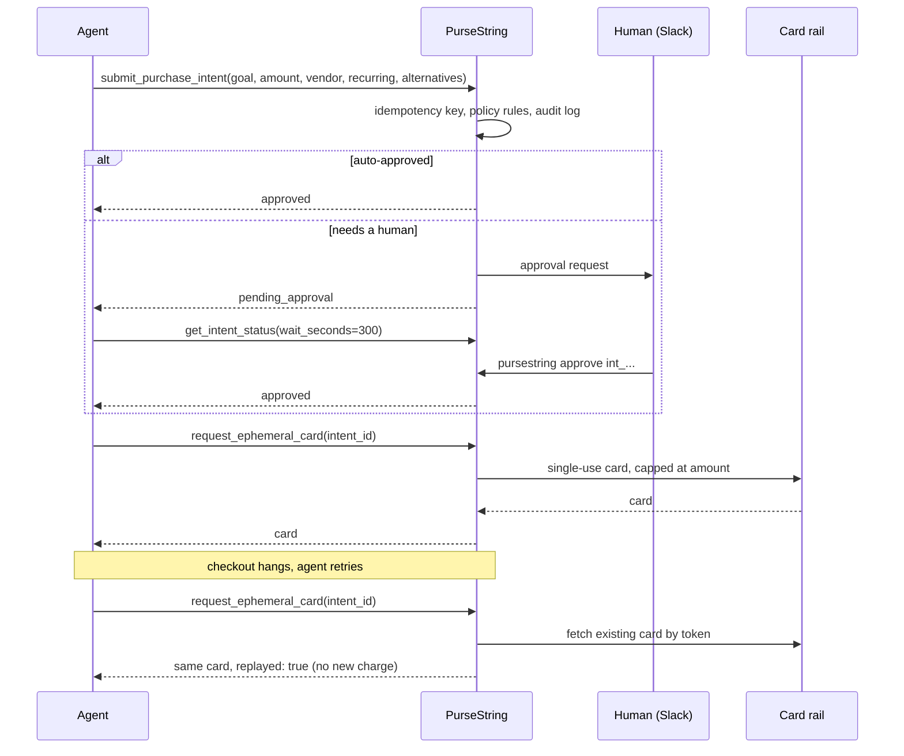
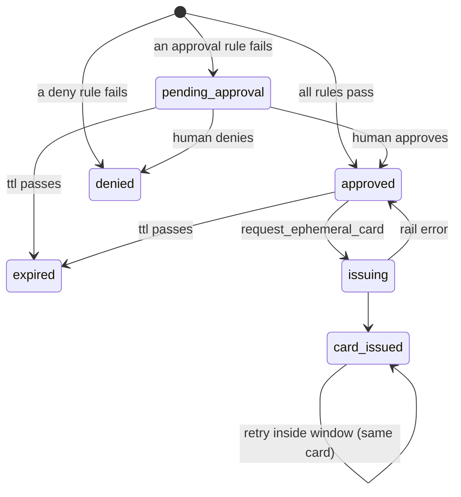

# How PurseString works

PurseString is a control plane. Agents talk to it over MCP; it talks to a payment rail through an adapter. Money only moves after a decision has been made and written down.



## The intent

| Field | Why it's required |
|---|---|
| `agent_id`, `task_id` | Who is spending, for what. Half of the idempotency key, and the unit for daily budgets. |
| `task_goal` | Forces the agent to state the purpose. Goes in the approval message and the log. |
| `vendor_domain`, `amount`, `currency` | What the card will be locked to. |
| `is_recurring` | Subscriptions are the highest-risk spend because they keep charging. They always go to a human by default. |
| `alternatives_attempted` | Did the agent try the free option first? No alternatives means a human looks. |
| `reasoning` (optional) | The agent's step-by-step reasoning, stored verbatim in the log. |

## Intent lifecycle



## The decision log

`$PURSESTRING_HOME/decisions.jsonl` is append-only, one JSON object per event. Events: `policy_checked`, `intent_submitted`, `duplicate_intent_blocked`, `human_approved`, `human_denied`, `card_issued`, `card_replayed`, `card_issue_failed`.

An `intent_submitted` entry carries the full reasoning tree:

```json
{
  "ts": "2026-10-14T20:21:27.411Z",
  "event": "intent_submitted",
  "intent_id": "int_19099cd4d52542c2a33f",
  "idempotency_key": "fba9d925…",
  "intent": { "agent_id": "invoice-bot", "task_id": "102", "amount": 15, "vendor_domain": "pdfocr.io", "is_recurring": true, "…": "…" },
  "reasoning_tree": {
    "goal": "Parse invoice PDF for task #102",
    "alternatives_attempted": ["PyPDF2 (failed OCR)"],
    "agent_reasoning": [],
    "policy_rules": [
      { "rule": "hard_limits.max_amount", "passed": true, "effect": "deny", "detail": "15.00 USD vs hard cap 1000.00 USD" },
      { "rule": "require_approval.recurring", "passed": false, "effect": "require_approval", "detail": "recurring charge: will renew until cancelled" }
    ],
    "decision": "require_approval",
    "summary": "Needs human approval: require_approval.recurring (recurring charge: will renew until cancelled)"
  },
  "status": "pending_approval",
  "policy_file": "/home/me/project/policies.yaml"
}
```

Card events record the rail, the card token and the last four digits. Full card numbers and CVVs are never written to the log or to `state.json`.

## Payment adapters

An adapter is two methods:

```ts
interface CardAdapter {
  readonly name: string;
  issueCard(req: IssueCardRequest): Promise<CardDetails>;   // create a card capped at req.amount
  getCard(ref: CardReference): Promise<CardDetails>;        // re-fetch a card by token, for replays
}
```

`single_use` on the request tells the adapter whether this is a one-time spend (close after one authorization) or an approved recurring spend (merchant-locked, monthly cap). See [`src/adapters/lithic.ts`](../src/adapters/lithic.ts) for a real one and [`src/adapters/mock.ts`](../src/adapters/mock.ts) for the simplest. Adding a rail is described in [CONTRIBUTING.md](../CONTRIBUTING.md#adding-a-payment-rail).

## Source map

| File | What's in it |
|---|---|
| `src/server.ts` | The four MCP tools and what the agent is told after each call |
| `src/governance.ts` | The control plane: submit, dedupe, issue, replay, approve |
| `src/policy.ts` | Pure rule evaluation and domain matching |
| `src/store.ts` | Locked JSON state, idempotency key, audit log |
| `src/notify.ts` | Slack and Discord webhooks |
| `src/adapters/` | Payment rails |
| `src/http.ts` | Streamable HTTP transport and the approval API |
| `src/index.ts` | CLI entry point |
