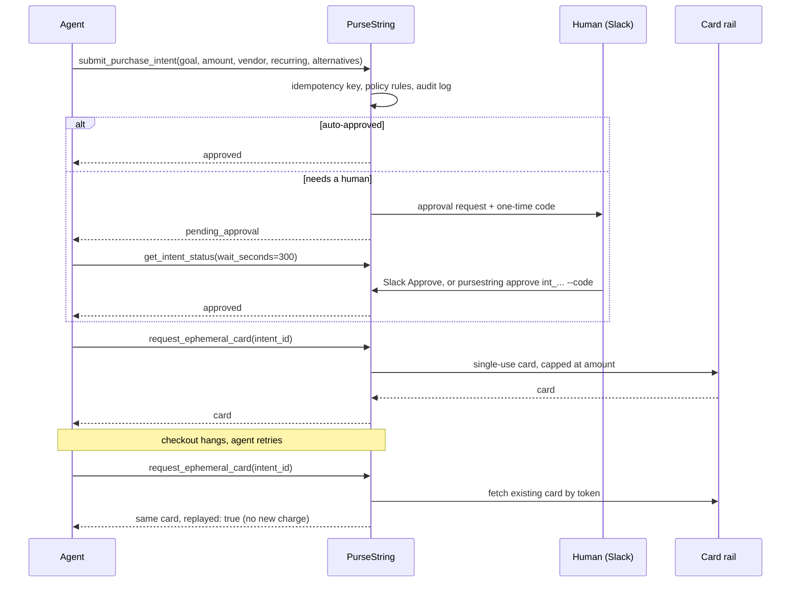
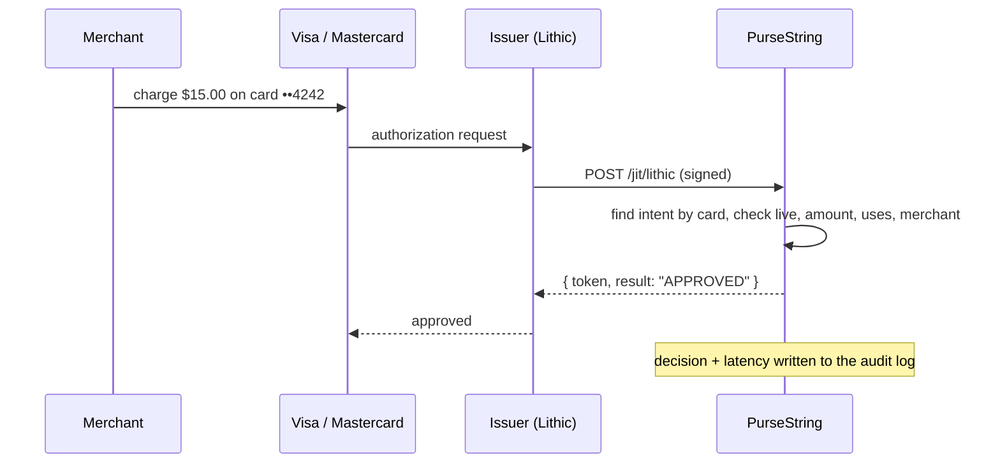
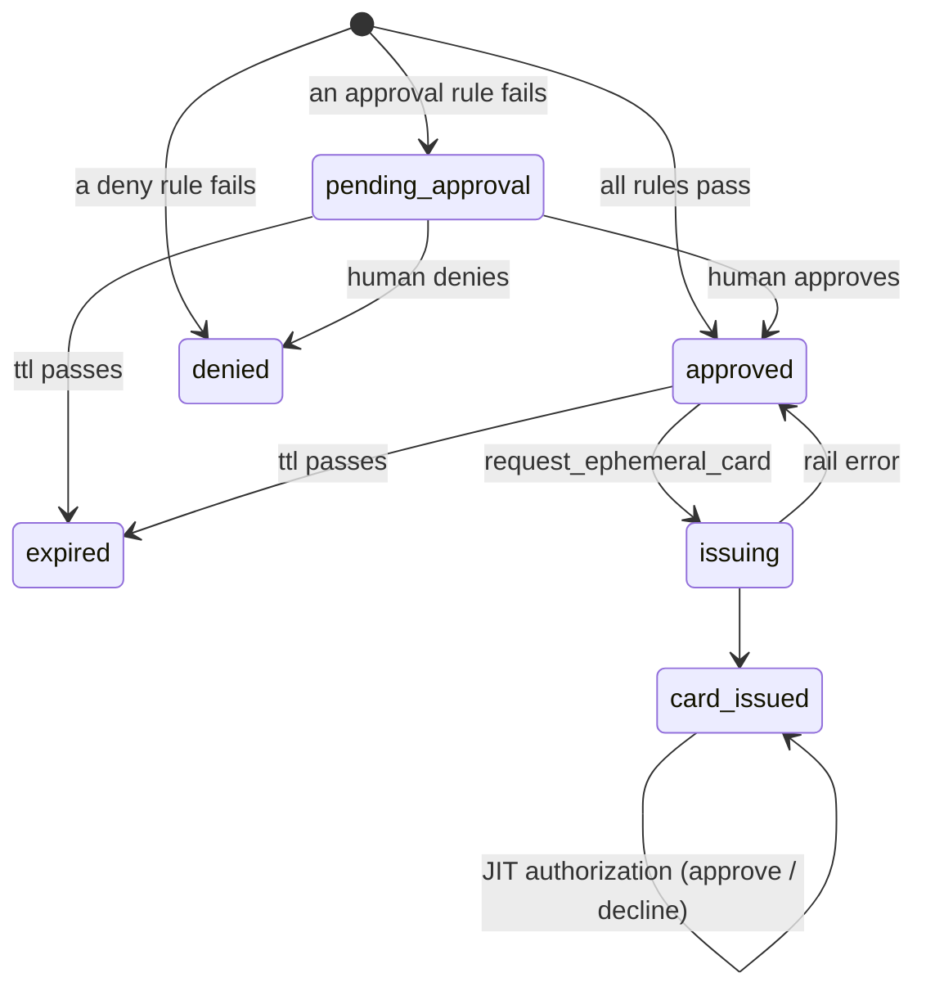

# How PurseString works

PurseString is a control plane. Agents talk to it over MCP; it talks to a payment rail through an adapter. Money only moves after a decision has been made and written down.



## Rail routing

At submit time, policy picks the rail for the purchase from `routes` in `policies.yaml` (first match on amount, vendor and recurrence, else `adapter.type`). The rail is recorded on the intent, shown to the approver in Slack, and returned to the agent. A purchase routed to a bank-transfer rail never gets a card.

| Rail | Kind | Status |
|---|---|---|
| `mock` | card | ✅ test cards, no network |
| `lithic` | card | ✅ sandbox and production, JIT authorization via ASA |
| `privacy` | card | ✅ Privacy.com cards funded from the user's own bank account (production only, no real-time authorization) |
| `highnote` | card | planned (commercial charge cards) |
| `marqeta` | card | planned (JIT funding) |
| `amex` | card | planned (Amex single-use virtual numbers on a corporate line) |
| `network_token` | card | planned (the user's own Visa / Mastercard via Visa Intelligent Commerce and Mastercard Agent Pay, [#20](https://github.com/suseendar1414/pursestring/issues/20)) |
| `ach` | bank transfer | planned (ACH / wire / SEPA via treasury APIs) |

A planned rail can already be named in `routes`; a purchase routed to it stops with an error that links to its issue, instead of silently falling back to another rail.

## Just-in-time authorization

Issuing a card capped at the amount is the first line of defence. The second is answering the issuer's real-time authorization webhook. When a merchant charges a PurseString card, the issuer asks *"Merchant X wants $45 on card Y. Approve?"* and PurseString checks the charge against the intent the card was issued for:



| Check | Declines with (Lithic ASA result) |
|---|---|
| The card belongs to a PurseString intent that has a card issued | `CARD_PAUSED` |
| A single-use card is still inside its TTL and not closed | `CARD_PAUSED` |
| A single-use card hasn't been charged before | `VELOCITY_EXCEEDED` |
| The amount is within the approved amount (+ `jit.tolerance_percent`); for subscriptions, within the monthly cap | `INSUFFICIENT_FUNDS` |
| The merchant descriptor mentions the vendor (only if `jit.require_merchant_match`) | `UNAUTHORIZED_MERCHANT` |

Decisions are local (one locked JSON read) and take a few milliseconds, well inside Lithic's 6-second limit. Requests must carry a valid [Standard Webhooks](https://www.standardwebhooks.com) signature made with your Lithic ASA HMAC key (`LITHIC_WEBHOOK_SECRET`). Other rails can call the generic `POST /jit/authorize` with the admin token. To try it locally on the mock rail: `pursestring simulate-charge <intent_id> <amount>`.

## Short-lived cards

Single-use cards close `cards.ttl_minutes` (default 10) after issue. JIT authorization declines them from that moment, `request_ephemeral_card` stops replaying them, and a background sweep closes them at the rail. Approved subscriptions get a merchant-locked card with a monthly cap instead, since they have to keep renewing.

## The intent

| Field | Why it's required |
|---|---|
| `agent_id`, `task_id` | Who is spending, for what. Half of the idempotency key, and the unit for daily budgets. |
| `task_goal` | Forces the agent to state the purpose. Goes in the approval message and the log. |
| `vendor_domain`, `amount`, `currency` | What the card will be locked to. |
| `is_recurring` | Subscriptions are the highest-risk spend because they keep charging. They always go to a human by default. |
| `alternatives_attempted` | Did the agent try the free option first? No alternatives means a human looks. |
| `reasoning` (optional) | The agent's step-by-step reasoning, stored verbatim in the log. |

## Intent lifecycle



## The decision log

`$PURSESTRING_HOME/decisions.jsonl` is append-only, one JSON object per event. Events: `policy_checked`, `intent_submitted`, `duplicate_intent_blocked`, `human_approved`, `human_denied`, `card_issued`, `card_replayed`, `card_issue_failed`, `jit_authorization`, `card_closed`, `card_close_failed`.

An `intent_submitted` entry carries the full reasoning tree:

```json
{
  "ts": "2026-10-14T20:21:27.411Z",
  "event": "intent_submitted",
  "intent_id": "int_19099cd4d52542c2a33f",
  "idempotency_key": "fba9d925…",
  "intent": { "agent_id": "invoice-bot", "task_id": "102", "amount": 15, "vendor_domain": "pdfocr.io", "is_recurring": true, "…": "…" },
  "reasoning_tree": {
    "goal": "Parse invoice PDF for task #102",
    "alternatives_attempted": ["PyPDF2 (failed OCR)"],
    "agent_reasoning": [],
    "policy_rules": [
      { "rule": "hard_limits.max_amount", "passed": true, "effect": "deny", "detail": "15.00 USD vs hard cap 1000.00 USD" },
      { "rule": "require_approval.recurring", "passed": false, "effect": "require_approval", "detail": "recurring charge: will renew until cancelled" }
    ],
    "decision": "require_approval",
    "summary": "Needs human approval: require_approval.recurring (recurring charge: will renew until cancelled)"
  },
  "status": "pending_approval",
  "policy_file": "/home/me/project/policies.yaml"
}
```

Card events record the rail, the card token and the last four digits. Full card numbers and CVVs are never written to the log or to `state.json`.

## Payment adapters

An adapter is two methods:

```ts
interface CardAdapter {
  readonly name: string;
  readonly kind: "card" | "bank_transfer";
  issueCard(req: IssueCardRequest): Promise<CardDetails>;   // create a card capped at req.amount
  getCard(ref: CardReference): Promise<CardDetails>;        // re-fetch a card by token, for replays
  closeCard?(ref: CardReference): Promise<void>;            // close a single-use card when its time is up
}
```

`single_use` on the request tells the adapter whether this is a one-time spend (close after one authorization) or an approved recurring spend (merchant-locked, monthly cap). See [`src/adapters/lithic.ts`](../src/adapters/lithic.ts) for a real one and [`src/adapters/mock.ts`](../src/adapters/mock.ts) for the simplest. Adding a rail is described in [CONTRIBUTING.md](../CONTRIBUTING.md#adding-a-payment-rail).

## Source map

| File | What's in it |
|---|---|
| `src/server.ts` | The four MCP tools and what the agent is told after each call |
| `src/governance.ts` | The control plane: submit, dedupe, issue, replay, approve |
| `src/policy.ts` | Pure rule evaluation, rail routing and domain matching |
| `src/store.ts` | Locked JSON state, idempotency key, audit log |
| `src/notify.ts` | Slack and Discord webhooks |
| `src/adapters/` | Payment rails (`planned.ts` holds the not-yet-built ones) |
| `src/webhooks.ts` | Standard Webhooks signature verification for issuer callbacks |
| `src/http.ts` | Streamable HTTP transport, the approval API and the JIT endpoints |
| `src/index.ts` | CLI entry point |
